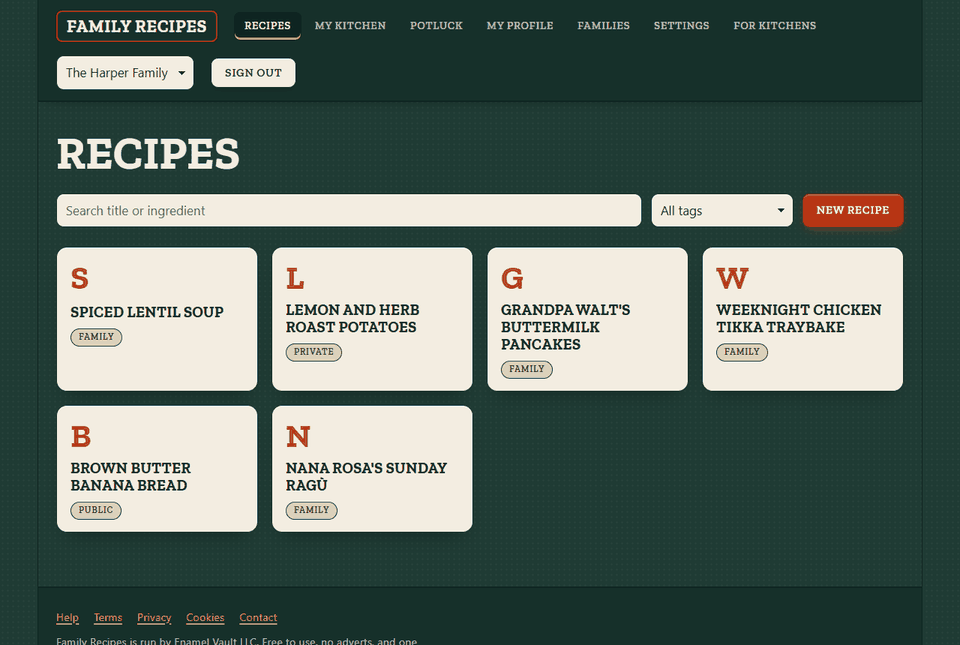
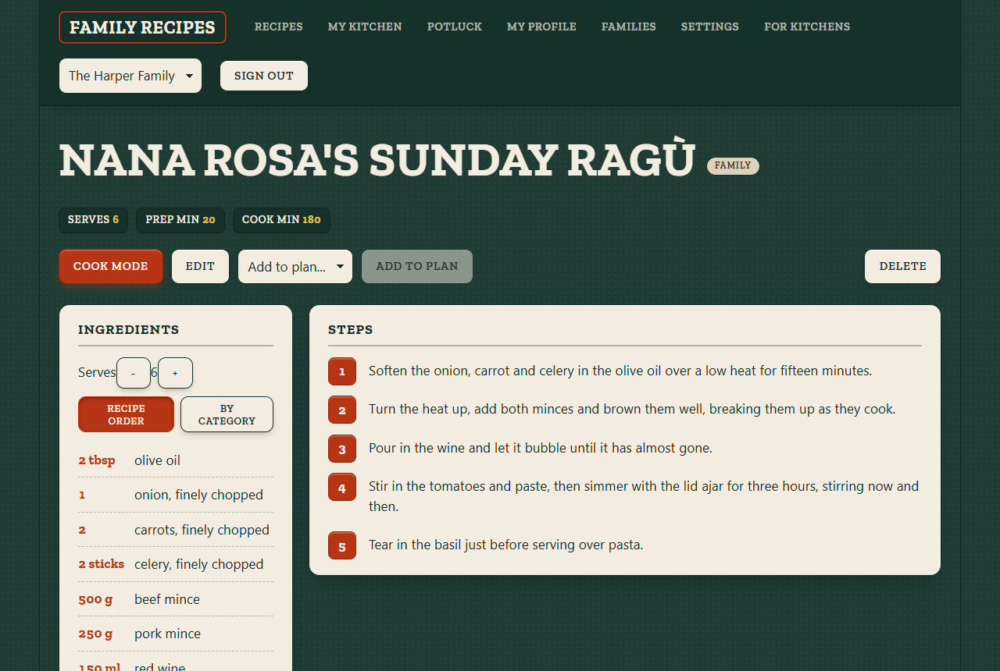
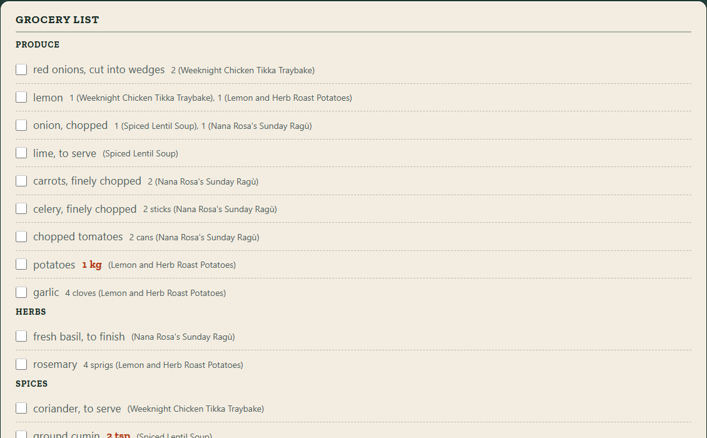
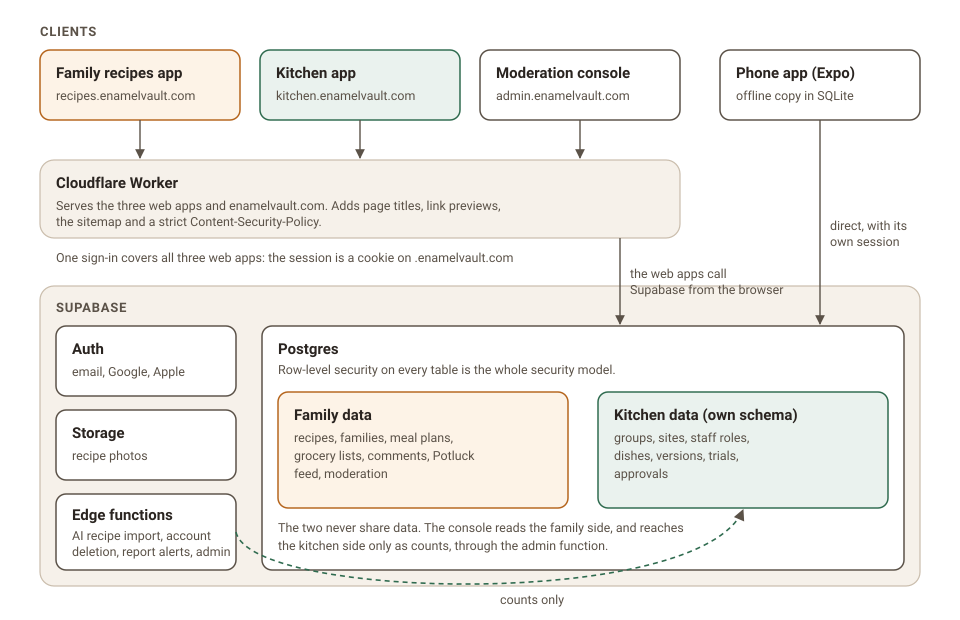

# Enamel Vault

Recipes kept properly, for families and for professional kitchens. Two apps on one codebase,
with one design system and one sign-in.

**Try it:** [enamelvault.com](https://enamelvault.com) ·
[Family recipes](https://recipes.enamelvault.com) ·
[Kitchen](https://kitchen.enamelvault.com)

Built by Aayush Pokhrel · Operated by Enamel Vault LLC ·
[GitHub](https://github.com/aayushpokhrel1)

<!-- DEMO GIF: uncomment once screenshots/demo.gif exists

-->

## What it is

Enamel Vault has two products that share a design and a sign-in but never share data.

The **family recipes app** is a private recipe vault for families: the dishes you grew up
with, kept with their photos and the story of where they came from, plus the weekly cooking
and shopping that happen around them.

The **kitchen app** is for restaurant groups developing dishes: every revision of a dish is
kept, it is trialled at one site, and one version is signed off for the menu.

## The family recipes app

- Belong to several families, switch between them, and invite people with a link.
- Add recipes by hand, or let AI draft one from pasted text, a web page, a photo of a
  handwritten card, or your voice. You always review the draft before it is saved.
- Keep a recipe private, share it with your family, or publish it to Potluck, a feed where
  cooks follow each other and save copies that keep the original cook's name.
- Plan the week on a grid, and get a grocery list grouped by supermarket aisle and scaled to
  each meal's servings. Share the plan, and everyone it is shared with shops from one list
  that updates live on every phone.
- Keep a cupboard of what you already have, so the list stops telling you to buy it.
- Cook from Cook Mode: one step at a time in big text, with the screen kept awake and the
  amounts for that step already scaled.

<!-- FAMILY SCREENSHOTS: uncomment once the files exist

-->

## The kitchen app

- Take a dish from development, through a trial at one site, to the group menu.
- Keep every revision, and sign off exactly one version.
- Publish the approved version to Potluck under the venue's name.
- See where dishes stall, how long they take to land, and which sites are active.
- Give cooks, chefs and owners different powers, enforced by the database rather than by
  hiding buttons.

<!-- KITCHEN SCREENSHOTS: uncomment once the files exist

-->

## How it's built

- **Frontend:** React, TypeScript and Vite, as three separate web apps (family, kitchen, and
  a moderation console) served by one Cloudflare Worker.
- **Backend:** Supabase. Postgres with row-level security on every table is the entire
  security model, plus Auth, Storage and four edge functions.
- **Phone:** an Expo app for the family side that works offline, with a local SQLite copy
  and timers that ring while the phone is locked. It is built but has not yet run on a real
  phone.
- **Tests:** about 1,700 unit tests and over 300 integration tests that run against a real
  database as ordinary users, so a security rule is tested by trying to break it.

## Case studies

Short write-ups of problems I found and fixed, and what stops each one coming back.

- [Offboarding an employee increased their access](case-studies/offboarding-raised-access.md):
  a `NULL` in a Postgres permission check let removed staff do more than current staff.
- [A refused write is not an error](case-studies/silent-refused-writes.md): the database
  blocked writes silently, so the app said "Saved" when nothing was.
- [A test that passed without looking](case-studies/a-test-that-passed-blind.md): a guard
  reported success while it couldn't see what it guarded.
- [Editing recipes with no signal](case-studies/offline-first-phone-sync.md): how the phone
  app queues edits offline and handles conflicts.

## Source code

The source is private. It's available on request: write to
[hello@enamelvault.com](mailto:hello@enamelvault.com).
